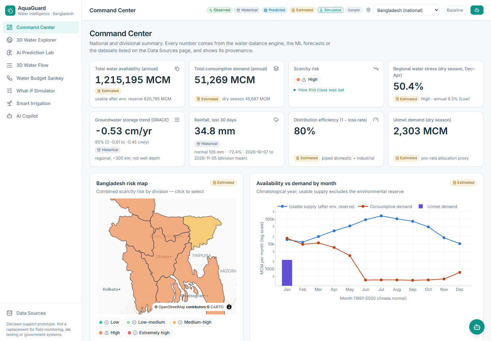

# BlueSense

**Predict water risk, protect every drop**

AI-powered water intelligence, prediction and resource optimization for Bangladesh.

BlueSense is a software-only decision-support prototype that brings public weather, water-resource and satellite datasets into one workspace. Users can inspect historical conditions, compare water supply and demand, explore climate forecasts, estimate irrigation needs and test resource-allocation scenarios.

The application lives in [`aquaguard/`](aquaguard/). This directory name, `AQUAGUARD_*` environment variables, database filename and internal source IDs remain for compatibility; the project and interface are **BlueSense**.




*Historical screenshot; the current interface includes subsequent layout cleanups.*

## Purpose and scope

BlueSense connects **Predict → Analyze → Visualize → Optimize → Recommend**. It covers Bangladesh and eight divisions, with 64 district boundaries as geographic reference. Weather uses one representative point per division. National statistics remain national; district boundaries do not imply district-level hydrological observations.

The prototype supports planning and education. It does not operate sensors, detect physical pipe leaks, control infrastructure, certify water quality or replace field monitoring and government systems. Historical records, predictions, estimates and simulations have distinct labels.

## Modules

| Module | Route | Capabilities |
|---|---|---|
| Command Center | `/command-center` | Source-labelled KPIs, regional conditions, insights, historical weather charts and division comparison |
| Water Rhythm | Within Command Center | Monthly rainfall anomaly, climatic water balance and three-month dryness; playback, date filters and missing-data gaps |
| 3D Water Explorer | `/explorer` | Terrain, boundaries, rivers, JRC surface water, GRACE cells, weather points, history, tables and descriptive spatial intelligence; 2D fallback |
| AI Prediction Lab | `/prediction-lab` | One-, three- and six-month climatic water-balance forecasts, uncertainty, baseline comparisons, SHAP, demand projection and GRACE anomaly history and projection |
| 3D Water Flow | `/water-flow` | Hypothetical network with pump, valve, allocation, demand and leak controls; pressure optimization, schematic and table views |
| Water Budget Sankey | `/water-budget` | National AQUASTAT flows with genuine reference years; separate derived monthly balance, allocation optimization and custom shares |
| What-if Simulator | `/what-if` | Rainfall, temperature, domestic/industrial demand, agricultural consumption, groundwater availability, irrigation efficiency and pipeline-loss scenarios |
| AI Copilot | `/copilot` and floating panel | Gemini by default, optional Anthropic; streamed answers through read-only backend tools and explicit configuration/provider errors |
| Settings | `/settings` | Region, units, motion and transparency preferences |

Source documentation is in [Data Sources](aquaguard/docs/DATA_SOURCES.md). The former `/data-sources` screen is currently disabled; the repository documentation remains available.

## Architecture

| Layer | Implementation |
|---|---|
| Frontend | Next.js 15 App Router, React 19, TypeScript, Tailwind CSS and Zustand; Plotly, D3 Sankey, MapLibre GL and React Three Fiber |
| Backend | FastAPI, Pydantic schemas, typed responses and shared calculation engines |
| Storage | SQLite in WAL mode, versioned migrations, verified pre-change backups and provenance metadata |
| Ingestion | Bootstrap from committed processed datasets; scheduled adapters for Open-Meteo, FAO AQUASTAT and CSR GRACE |
| ML | Python, pandas, scikit-learn, XGBoost and SHAP; offline training and stored artifacts |
| Copilot | Server-side credentials, validated read-only tools, streaming, deadlines, bounded retries and usage limits |

```text
Public datasets → ingestion / cleaning → SQLite ← trained ML artifacts
                                           ↓
                             FastAPI services + shared engines
                                           ↓
                           Typed API → Next.js modules and Copilot
```

The browser calls the API; it has no runtime mock-data mode. An offline run reads stored records with original dates. Missing or stale inputs remain visible as such. A missing database is bootstrapped from committed processed files without downloading raw datasets.

```text
BlueSense/
├── README.md                  Project overview and submission entry point
├── render.yaml                Backend deployment blueprint
└── aquaguard/
    ├── backend/               API, engines, services, migrations, sync and tests
    ├── frontend/              Application, components, unit and browser tests
    ├── ml/                    Ingestion, features, training and artifacts
    ├── data/processed/        Committed bootstrap datasets
    ├── data/geo/              Geographic reference data
    ├── docs/                  Architecture, methods, model card and demo
    ├── deploy/                Deployment helpers
    ├── .env.example           Configuration template without credentials
    └── Makefile               Development and verification workflows
```

See [Architecture](aquaguard/docs/ARCHITECTURE.md) and [API](aquaguard/docs/API.md). Interactive API documentation: `http://localhost:8001/api/docs`.

## Methods and provenance

| Method | Calculation and interpretation |
|---|---|
| Water balance | Surface plus groundwater supply reconciles with delivered water, losses and unallocated water/storage. The derived balance closes within 0.01 MCM. Spatial splits are assumptions. |
| Irrigation | FAO-56: `ETc = Kc × ET0`; net requirement accounts for effective rainfall and crop assumptions; gross requirement divides by efficiency. `Volume (m³) = gross mm × hectares × 10`. Validate advice locally. |
| Scenarios | Seven explicit levers perturb inputs to the shared engines. Outputs are simulated, not observed outcomes or forecasts. |
| Allocation | Linear programming prioritizes domestic delivery while respecting supply, sector need and environmental reserve; allocations are rechecked by the balance engine. |
| Hydraulics | Hazen–Williams head loss and pressure-dependent leakage on a hypothetical steady-state network. Pumped flow equals delivered flow plus leakage; storage dynamics are not modelled. |
| Water Rhythm | Rainfall minus the 1991–2020 normal; raw `P − ET0`; three-month normal z-score requiring at least 25 complete reference windows. National dryness averages eight point scores by area. This is not gamma-fitted SPI. |
| GRACE | Regional terrestrial water-storage anomaly and trend, roughly 300 km effective resolution; not groundwater depth or well measurements. |

Responses distinguish data kind, source, observed/reference date, retrieval date, spatial level and freshness where applicable. Recent retrieval does not make an old statistic current. Equations, parameters and references: [Methods](aquaguard/docs/METHODS.md) and [Assumptions](aquaguard/docs/ASSUMPTIONS.md).

## Model card summary

The target is monthly **climatic water balance `D = precipitation − reference evapotranspiration`**, in mm, at one-, three- and six-month horizons. It is not a direct forecast of available water or groundwater depth.

The committed model card uses January 1991–October 2026 data, split by target date: train through 2016, validation 2017–2020, test from 2021 onward. Random Forest and XGBoost are compared by validation RMSE. The selected Random Forest is evaluated against climatology and persistence; operational models are subsequently refit on labelled data.

| Horizon | Model test RMSE (mm) | Climatology RMSE (mm) | Nominal 90% interval test coverage |
|---|---:|---:|---:|
| 1 month | 118.542 | 125.791 | 83.93% |
| 3 months | 121.090 | 125.791 | 81.61% |
| 6 months | 125.108 | 125.791 | 83.21% |

These are stored evaluation results, not a new training run. Improvement over climatology is modest; dry-class detection is weak, and interval coverage is below nominal. SHAP explains model contributions, not causality. See the full [Model Card](aquaguard/docs/MODEL_CARD.md).

## Setup

Prerequisites: Python 3.11+ and Node.js 20+. Use a Python version supported by the pinned dependencies; the Docker image uses Python 3.14. Initial dependency installation and Next.js Google-font downloads require network access.

From the repository root in **Windows PowerShell**:

```powershell
Set-Location aquaguard
python -m venv .venv
.\.venv\Scripts\python.exe -m pip install -r requirements-dev.txt
Set-Location frontend
npm.cmd ci
Set-Location ..
if (-not (Test-Path backend/.env)) { Copy-Item .env.example backend/.env }
.\.venv\Scripts\python.exe ml/build_db.py
```

Start the backend from `aquaguard/`:

```powershell
Set-Location backend
..\.venv\Scripts\python.exe -m uvicorn app.main:app --reload --port 8001
```

In a second terminal, from the repository root:

```powershell
Set-Location aquaguard/frontend
npm.cmd run dev
```

Open `http://localhost:3000/command-center` (the root URL redirects here). Backend health: `http://localhost:8001/api/health`.

On **macOS/Linux**, use `.venv/bin/python` instead of `.venv/Scripts/python.exe`, and `npm` instead of `npm.cmd`. With GNU Make installed, run `make setup`, `make db`, `make dev-backend` and `make dev-frontend` from `aquaguard/`.

### Configuration

The backend loads `aquaguard/backend/.env`; existing process variables take precedence. Restart after editing it. Public frontend settings belong in `aquaguard/frontend/.env.local` when needed.

| Variable | Purpose |
|---|---|
| `NEXT_PUBLIC_API_URL` | Public backend URL; default `http://localhost:8001`; set before frontend builds |
| `CORS_ORIGINS` | Allowed frontend origins, comma-separated |
| `AQUAGUARD_DB_PATH` | Database path; default `aquaguard/data/aquaguard.db` |
| `AQUAGUARD_OFFLINE=1` | Disable outbound data calls and scheduled sync; read stored records |
| `AQUAGUARD_SCHEDULER_ENABLED=1` | Enable refresh jobs; off by default |
| `ADMIN_TOKEN` | Server-only token for administrative sync endpoints |
| `LLM_PROVIDER` | `gemini` by default; also supports `anthropic` |
| `GEMINI_API_KEY` / `ANTHROPIC_API_KEY` | Selected provider credential; server-side only |
| `LLM_MODEL` | Optional model override |
| `LLM_CALL_TIMEOUT_S` / `COPILOT_DEADLINE_S` | Per-call wait and question budget; defaults 60 / 240 seconds |
| `LLM_MAX_RETRIES` / `LLM_RETRY_AFTER_MAX_S` | Bounded Gemini retries before output; quota retries require a provider delay within budget |

Without its selected provider key, Copilot reports `not_configured` and generates no fallback answers. Provider identity and usage limits appear in the app; processing terms are documented in the limitations guide. Never commit `.env` files or expose secrets through `NEXT_PUBLIC_*`. Full settings: [`.env.example`](aquaguard/.env.example).

### Data workflows

Optional GNU Make commands, from `aquaguard/`:

```bash
make db             # idempotent import, preserving data with a pre-import backup
make migrate-status # inspect migration state
make migrate        # pending migrations with a verified backup
make sync-status    # source freshness
make sync           # refresh due sources; requires network
make data           # fetch raw sources, process and import
make ml             # features, training, evaluation, forecasts, SHAP, model card, DB
make mocks          # OpenAPI export and TypeScript generation; no runtime mocks
```

Raw data and SQLite databases are Git-ignored. Rebuilding raw inputs includes a large GRACE download and rate-limited weather requests. A clean checkout can start from committed processed data; full AQUASTAT history and GRACE grid cells require source ingestion. Missing inputs remain unavailable.

## Verification

From `aquaguard/` in PowerShell:

```powershell
.\.venv\Scripts\python.exe -m pytest -q
.\.venv\Scripts\python.exe -m ruff check backend ml
Set-Location frontend
npm.cmd test
npm.cmd run lint
npm.cmd run typecheck
npm.cmd run build
npx.cmd playwright install chromium # first browser-test run only
npm.cmd run e2e
```

GNU Make alternatives: `make test`, `make lint`, `make build`. Browser tests use `.next-e2e` and an offline backend on a temporary database built from committed data and recorded provider fixtures. Historical reports do not certify the current working tree; consult the current submission audit for results and blockers.

## Demo walkthrough

The official submission checklist calls for a **2-3 minute YouTube demo**. Use the [2:45 submission-video plan](aquaguard/docs/CLOUDCAMP_SUBMISSION.md#two-to-three-minute-submission-video). The walkthrough below is an extended rehearsal.

Allow about seven minutes for rehearsal. Prepare the database and frontend, check backend health and source freshness, and configure Copilot if demonstrating generated answers. Use displayed dates and values.

1. **Command Center:** explain provenance, inspect a KPI and select a division; distinguish national statistics from point weather.
2. **Water Rhythm:** scrub a month, switch rainfall anomaly / raw balance / dryness and explain gaps.
3. **What-if:** select a dry-year preset and compare baseline with simulated demand and stress. Historical records remain historical.
4. **Water Budget:** distinguish national reference-year flows from the derived model; show the derived balance check and optimizer.
5. **Prediction Lab:** compare held-out results with both baselines; explain uncertainty, SHAP and weak dry-class detection.
6. **Explorer:** inspect a point or GRACE cell, switch to history/table and explain district and resolution limits.
7. **Water Flow:** add a hypothetical leak and optimize pressure. Identify this as conceptual simulation.
8. **Irrigation and Copilot:** estimate crop needs; ask about available data and something the system cannot know. Close with limitations and attribution.

Detailed rehearsal: [Demo Script](aquaguard/docs/DEMO_SCRIPT.md). Existing [screenshots](aquaguard/docs/screenshots/) are historical captures and may differ from the current interface.

Historical module screenshots: [explorer](aquaguard/docs/screenshots/explorer.png) · [prediction lab](aquaguard/docs/screenshots/prediction-lab.png) · [water flow](aquaguard/docs/screenshots/water-flow.png) · [water budget](aquaguard/docs/screenshots/water-budget.png) · [what-if](aquaguard/docs/screenshots/what-if.png) · [irrigation](aquaguard/docs/screenshots/irrigation.png)

## Deployment

- **Backend:** [`render.yaml`](render.yaml) builds [`backend/Dockerfile`](aquaguard/backend/Dockerfile) with `aquaguard/` as context. Configure actual frontend origins and server-side secrets in the host. Health check: `/api/health`.
- **Frontend:** deploy `aquaguard/frontend/` to Vercel or a compatible Node host; set `NEXT_PUBLIC_API_URL` before building.
- **Persistence:** the included free-host blueprint has no persistent disk. Configure persistence if synced records must survive restarts; a rebuild starts from committed seed data.
- **Refresh:** enable the scheduler on the intended host. Sleeping hosts can serve stale data, retaining original dates.
- **Demo helper:** [`deploy/keep-warm.yml`](aquaguard/deploy/keep-warm.yml) is a workflow template, not an active GitHub Actions workflow in its current location.

## Limitations and attribution

AQUASTAT has old and mixed reference years. Weather points are not division-wide measurements. Spatial allocations and crop/soil parameters are assumptions. GRACE measures regional storage anomalies; no measured well dataset is bundled. Hydraulic scenarios are hypothetical. Forecast skill and uncertainty calibration are limited. Copilot can make mistakes; number checks do not prove correctness.

Sources include Open-Meteo, Copernicus ERA5/ERA5-Land and GloFAS, FAO AQUASTAT, CSR GRACE/GRACE-FO, geoBoundaries, HDX, World Bank, JRC Global Surface Water, AWS Terrain Tiles and OpenStreetMap/CARTO. Source-specific attribution and licences apply, including non-commercial restrictions on some inputs. See [Data Sources](aquaguard/docs/DATA_SOURCES.md) and [Limitations](aquaguard/docs/LIMITATIONS.md).

### Source attribution

Weather: Open-Meteo.com (CC BY 4.0), ERA5/ERA5-Land © Copernicus Climate Change Service; GloFAS © Copernicus Emergency Management Service. FAO AQUASTAT (CC BY-NC-SA 4.0). CSR GRACE/GRACE-FO RL06.3 mascons (Save et al. 2016; Save 2020). geoBoundaries (Runfola et al. 2020; ADM1 CC0, ADM2 CC BY 3.0 IGO). HDX COD-PS (UNFPA, US Census Bureau). World Bank (CC BY 4.0). JRC Global Surface Water (Pekel et al. 2016). Terrain: AWS Terrain Tiles. Basemap © OpenStreetMap contributors, © CARTO.

## Documentation and submission status

| Document | Contents |
|---|---|
| [Application README](aquaguard/README.md) | Development workflows and Water Rhythm details |
| [Architecture](aquaguard/docs/ARCHITECTURE.md) / [API](aquaguard/docs/API.md) | Components, runtime boundaries and contracts |
| [Methods](aquaguard/docs/METHODS.md) / [Assumptions](aquaguard/docs/ASSUMPTIONS.md) | Equations and modelling choices |
| [Model Card](aquaguard/docs/MODEL_CARD.md) | Evaluation, features and intended use |
| [Data Sources](aquaguard/docs/DATA_SOURCES.md) / [Limitations](aquaguard/docs/LIMITATIONS.md) | Provenance, attribution and scientific limits |
| [Demo Script](aquaguard/docs/DEMO_SCRIPT.md) | Current walkthrough |
| [Implementation report](aquaguard/docs/aquaguard-final-report.md) | Historical phase results, not current certification |
| [CloudCamp submission alignment](aquaguard/docs/CLOUDCAMP_SUBMISSION.md) | Official fields, scoring inventory, eligibility gates and implementation plan |
| [Submission audit](aquaguard/docs/SUBMISSION_AUDIT.md) | Current checks, fixes and unresolved technical blockers |
| [Submission artifact package](aquaguard/docs/submission/README.md) | Reconstructed prompt, provenance, form drafts, pitch, video script and validation |

The complete CloudCamp BD knowledge base was retrieved through a fresh direct MCP session on **17 November 2026**. The owner confirmed **Idea to Unicorn**. The guide states a **31 October 2026, 11:59 PM GMT+6** preliminary deadline and a **one-master-prompt** rule for this track. Confirm the applicable round, any extension and acceptance of the available execution evidence before claiming eligibility. Its scoring totals are inconsistent; full marks cannot be certified. See the [source-based alignment and gap plan](aquaguard/docs/CLOUDCAMP_SUBMISSION.md).
