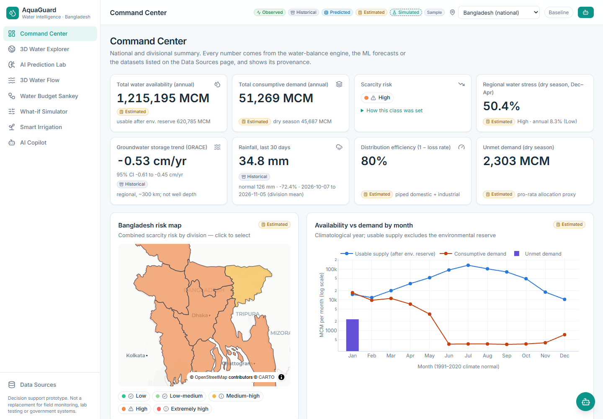

# AquaGuard — AI-Powered Water Intelligence, Prediction & Resource Optimization Platform

**Predict Water Risks. Optimize Water Resources. Protect Every Drop.**

AquaGuard is a software-only decision-support prototype for Bangladesh (national, 8 divisions, 64 districts). It combines public datasets (ERA5 reanalysis via Open-Meteo, FAO AQUASTAT, GRACE/GRACE-FO, GloFAS, geoBoundaries, HDX, World Bank) with a shared water-balance engine, FAO-56 irrigation maths, a hydraulic simulation and time-split machine learning. Flow: **Predict → Analyze → Visualize → Optimize → Recommend.**

Every number on screen is a `Measure` labelled **Observed, Historical, Predicted, Estimated or Simulated** (plus a **Sample** tag when it comes from the offline snapshot). AquaGuard has no IoT sensors, no real-time pipe pressure and no pump/valve control, and it does not replace field monitoring, laboratory testing or government water systems.



| Module | Route | What it does |
|---|---|---|
| Command Center | `/command-center` | KPIs, risk map, availability vs demand, sector use, 8-division comparison (CSV), alerts, trends |
| 3D Water Explorer | `/explorer` | MapLibre 3D terrain, rivers, JRC surface water, GRACE trend, scarcity extrusion, region panel |
| AI Prediction Lab | `/prediction-lab` | P − ET0 forecasts (1/3/6 mo) with intervals, test-period accuracy vs baselines, SHAP, demand projection, GRACE trend |
| 3D Water Flow | `/water-flow` | R3F network, Hazen–Williams + pressure-dependent leakage, pressure-management optimization |
| Water Budget Sankey | `/water-budget` | D3 Sankey, balance check (0.01 MCM), LP allocation optimizer, custom shares |
| What-if Simulator | `/what-if` | Six levers, presets, baseline vs simulated, "Apply across platform" |
| Smart Irrigation | `/irrigation` | FAO-56 with Open-Meteo forecast: requirement, timing, quantity, assumptions |
| AI Copilot | `/copilot` + floating panel | Answers only from platform data; LLM mode with number checking, rule-based fallback |
| Data Sources | `/data-sources` | Licences, retrieval times, every parameter and its source, limitations |

More screenshots: [explorer](docs/screenshots/explorer.png) · [prediction lab](docs/screenshots/prediction-lab.png) · [water flow](docs/screenshots/water-flow.png) · [water budget](docs/screenshots/water-budget.png) · [what-if](docs/screenshots/what-if.png) · [irrigation](docs/screenshots/irrigation.png)

## Architecture mode

**Mode A** — Next.js 15 (App Router, TypeScript, Tailwind v4, Zustand, Plotly, D3-sankey, MapLibre GL v6, React Three Fiber) + FastAPI (Pydantic v2) + an offline Python ML pipeline (pandas, scikit-learn, XGBoost, SHAP) + SQLite. See [docs/ARCHITECTURE.md](docs/ARCHITECTURE.md).

```
aquaguard/
├─ backend/   app/{main.py, routers/, engine/, services/, schemas/, db/, config/parameters.yaml}  tests/
├─ frontend/  app/<9 routes>  components/{layout,ui,charts,maps,three,copilot}  lib/{api,store,types,format}  tests/
├─ ml/        fetch_* → build_geo/process_weather/grace_trend → build_db → build_features → train → evaluate → predict → explain_shap → project_demand → model_card
├─ data/      raw/ (git-ignored) processed/ sample/ geo/
└─ docs/
```

## Setup

Requirements: Python 3.11+, Node 20+.

```bash
cd aquaguard
python -m venv .venv
.venv/Scripts/python -m pip install -r requirements-dev.txt      # Windows (use .venv/bin/python on macOS/Linux)
cd frontend && npm install && cd ..
cp .env.example backend/.env    # optional; set LLM_API_KEY to enable Copilot LLM mode
```

### Data and models

The repository ships the cleaned data (`data/processed`) and trained model artifacts (`ml/artifacts`). To build the database from them (the API also does this at startup when the database is missing):

```bash
make db            # = python ml/build_db.py  (idempotent: never replaces or shrinks the database)
make migrate       # apply pending schema migrations (backend/app/db/migrations), verified backup first
make migrate-status
```

The database schema is managed by versioned SQL migrations (`backend/app/db/migrate.py`); the API also applies
pending migrations at startup (`AQUAGUARD_MIGRATE_ON_STARTUP=1`). Backups go to `data/backups/` (git-ignored).
SQLite runs in WAL mode with `foreign_keys = ON` and `busy_timeout = 5000`. See `docs/aquaguard-plan.md`.

### Live data sync (P2)

Adapters in `backend/app/sync/` keep the database current: Open-Meteo forecast + current (hourly) and archive
top-up (daily), FAO AQUASTAT (weekly) and GRACE CSR RL06.3 (daily HEAD check; the ~110 MB file is downloaded only
when it changes). Re-runs are idempotent; missing values never overwrite stored ones; every run is logged in `sync_runs`.

```bash
make sync          # = cd backend && python -m app.sync.run all   (skips jobs that ran recently; --force to override)
make sync-status   # fresh / stale / unavailable / not_configured per source
```

Set `AQUAGUARD_SCHEDULER_ENABLED=1` to run the jobs inside the API (APScheduler; intervals `SYNC_*`, DB lease lock so
several workers never run the same job). Data shows `stale` when the last successful sync is older than
`SYNC_STALE_FACTOR` × the cadence (e.g. while free hosting sleeps).

To rebuild everything from the original sources (downloads ~125 MB incl. GRACE; the Open-Meteo archive takes ~12 minutes because of rate limits):

```bash
make data          # fetch → process → db   (GRACE: place the CSR NetCDF in data/raw/grace/ if the download is blocked)
make ml            # features → train → evaluate → predict → SHAP → demand projection → model card → db
make mocks         # OpenAPI spec + regenerated TypeScript types
```

### Run

```bash
make dev-backend   # FastAPI on http://localhost:8001  (docs at /api/docs)
make dev-frontend  # Next.js on http://localhost:3000  (frontend/.env.local: NEXT_PUBLIC_API_URL=http://localhost:8001)
```

Without `make`: `cd backend && ../.venv/Scripts/python -m uvicorn app.main:app --port 8001` and `cd frontend && npm run dev`.

Offline switch: `AQUAGUARD_OFFLINE=1` (no outbound calls; scheduled sync skipped). The backend has no sample/mock fallback (P2); the frontend mock mode (`NEXT_PUBLIC_API_MODE=mock`) is removed in P4.

### Test and lint

```bash
make test          # pytest (engines, API contract, migrations, sync adapters, scheduler, security, Copilot grounding) + vitest
make lint          # ruff, eslint, tsc
```

## Deploy

- **Backend**: Docker (`backend/Dockerfile`, build context `aquaguard/`) on Render (Blueprint `render.yaml` at the repository root), Railway or Fly.io. Set `CORS_ORIGINS` to the frontend URL; optionally `LLM_API_KEY`, `LLM_MODEL`. Health check `/api/health`.
- **Frontend**: Vercel, root directory `aquaguard/frontend`, env `NEXT_PUBLIC_API_URL=https://<backend>`.
- **Keep warm** for the demo: `deploy/keep-warm.yml` (GitHub Actions cron pinging `/api/health`).

## Documentation

[ARCHITECTURE](docs/ARCHITECTURE.md) · [API](docs/API.md) · [DATA_SOURCES](docs/DATA_SOURCES.md) · [METHODS](docs/METHODS.md) · [ASSUMPTIONS](docs/ASSUMPTIONS.md) · [LIMITATIONS](docs/LIMITATIONS.md) · [MODEL_CARD](docs/MODEL_CARD.md) · [DEMO_SCRIPT](docs/DEMO_SCRIPT.md)

## Data attribution

Weather: Open-Meteo.com (CC BY 4.0), ERA5/ERA5-Land © Copernicus Climate Change Service; GloFAS © Copernicus Emergency Management Service. FAO AQUASTAT (CC BY-NC-SA 4.0). CSR GRACE/GRACE-FO RL06.3 mascons (Save et al. 2016; Save 2020). geoBoundaries (Runfola et al. 2020; ADM1 CC0, ADM2 CC BY 3.0 IGO). HDX COD-PS (UNFPA, US Census Bureau). World Bank (CC BY 4.0). JRC Global Surface Water (Pekel et al. 2016). Terrain: AWS Terrain Tiles. Basemap © OpenStreetMap contributors, © CARTO.
