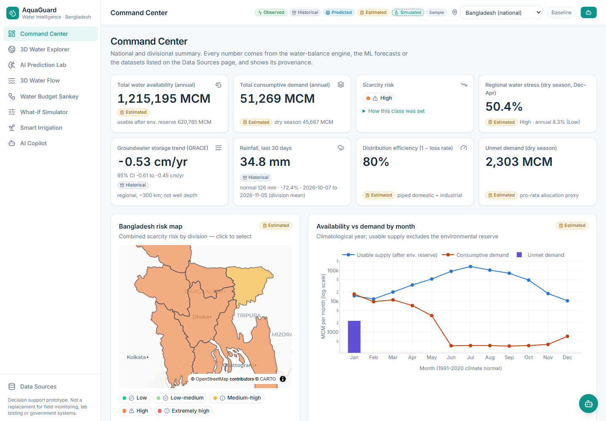

# BlueSense — AI-Powered Water Intelligence, Prediction & Resource Optimization Platform

**Predict water risk, protect every drop**

See the [repository README](../README.md) for the current project overview, methods, model-card summary, demo walkthrough and submission status. The `aquaguard/` directory and internal `AQUAGUARD_*` settings are retained for compatibility.

BlueSense is a software-only decision-support prototype for Bangladesh (national, 8 divisions, 64 districts). It combines public datasets (ERA5 reanalysis via Open-Meteo, FAO AQUASTAT, GRACE/GRACE-FO, GloFAS, geoBoundaries, HDX, World Bank) with a shared water-balance engine, FAO-56 irrigation maths, a hydraulic simulation and time-split machine learning. Flow: **Predict → Analyze → Visualize → Optimize → Recommend.**

API measures distinguish observations, historical data, predictions, estimates and simulations, with source, date, spatial level and freshness where applicable. Runtime views read the database; there is no sample fallback. BlueSense has no IoT sensors, no real-time pipe pressure and no pump/valve control, and it does not replace field monitoring, laboratory testing or government water systems.



| Module | Route | What it does |
|---|---|---|
| Command Center | `/command-center` | KPIs, risk map, availability vs demand, sector use, 8-division comparison (CSV), alerts, trends |
| 3D Water Explorer | `/explorer` | MapLibre 3D terrain, rivers, JRC surface water, GRACE trend, scarcity extrusion, region panel |
| AI Prediction Lab | `/prediction-lab` | P − ET0 forecasts (1/3/6 mo) with intervals, test-period accuracy vs baselines, SHAP, demand projection, GRACE trend |
| 3D Water Flow | `/water-flow` | R3F network, Hazen–Williams + pressure-dependent leakage, pressure-management optimization |
| Water Budget Sankey | `/water-budget` | D3 Sankey, balance check (0.01 MCM), LP allocation optimizer, custom shares |
| What-if Simulator | `/what-if` | Seven levers, presets, baseline vs simulated, "Apply across platform" |
| Smart Irrigation | `/irrigation` | FAO-56 with Open-Meteo forecast: requirement, timing, quantity, assumptions |
| AI Copilot | `/copilot` + floating panel | Gemini by default, optional Anthropic, 15 read-only BlueSense tools (14 data tools + `search_docs` documentation RAG), streamed answers and number checks; `not_configured` without a server-side key |
| Settings | `/settings` | Region, units, motion and transparency preferences |

The former `/data-sources` screen is disabled. See [DATA_SOURCES](docs/DATA_SOURCES.md) and `GET /api/sources` for attribution and parameters. The Command Center also includes the historical Water Rhythm timeline described below.

More screenshots: [explorer](docs/screenshots/explorer.png) · [prediction lab](docs/screenshots/prediction-lab.png) · [water flow](docs/screenshots/water-flow.png) · [water budget](docs/screenshots/water-budget.png) · [what-if](docs/screenshots/what-if.png) · [irrigation](docs/screenshots/irrigation.png)

## Architecture mode

**Mode A** — Next.js 15 (App Router, TypeScript, Tailwind v4, Zustand, Plotly, D3-sankey, MapLibre GL v6, React Three Fiber) + FastAPI (Pydantic v2) + an offline Python ML pipeline (pandas, scikit-learn, XGBoost, SHAP) + SQLite. See [docs/ARCHITECTURE.md](docs/ARCHITECTURE.md).

```
aquaguard/
├─ backend/   app/{main.py, routers/, engine/, services/, schemas/, db/, config/parameters.yaml}  tests/
├─ frontend/  app/<9 routes>  components/{layout,ui,charts,maps,three,copilot}  lib/{api,store,types,format}  tests/
├─ ml/        fetch_* → build_geo/process_weather/grace_trend → build_db → build_features → train → evaluate → predict → explain_shap → project_demand → model_card
├─ data/      raw/ (git-ignored) processed/ sample/ geo/
└─ docs/
```

## Setup

Requirements: Python 3.11+, Node 20+.

```bash
cd aquaguard
python -m venv .venv
.venv/Scripts/python -m pip install -r requirements-dev.txt      # Windows (use .venv/bin/python on macOS/Linux)
cd frontend && npm install && cd ..
cp .env.example backend/.env    # optional; set GEMINI_API_KEY to enable Copilot LLM mode
```

The backend automatically loads `backend/.env` at startup, regardless of the working directory. Set
`GEMINI_API_KEY` there with `LLM_PROVIDER=gemini`; no terminal environment commands are needed. Existing process
environment variables take precedence. Restart the backend after editing `.env`. Keys stay server-side; never put
them in frontend environment files or commit them to git.

Copilot waits up to `LLM_CALL_TIMEOUT_S=60` seconds for Gemini headers or the next streamed chunk, with a
`COPILOT_DEADLINE_S=240` second budget across tool rounds and retries. Gemini retries a transient failure once
before any answer text is delivered. Configure `LLM_MAX_RETRIES` (0–3, default 1) and `LLM_RETRY_BACKOFF_S`
(default 1 second) for exponential backoff. A quota response is retried only when Gemini supplies `Retry-After`
or `RetryInfo.retryDelay` within `LLM_RETRY_AFTER_MAX_S` (default 60 seconds) and the remaining question deadline.
Set `LLM_RETRY_AFTER_MAX_S=0` to disable quota retries. Exhausted retries return the existing timeout/quota error;
no provider switch occurs. `OPENAI_API_KEY` is not used: supported providers are Gemini and Anthropic.
The browser stream sends keepalives every 15 seconds while waiting; Stop
still cancels the browser request.

### Data and models

The repository ships the cleaned data (`data/processed`) and trained model artifacts (`ml/artifacts`). To build the database from them (the API also does this at startup when the database is missing):

```bash
make db            # = python ml/build_db.py  (idempotent: never replaces or shrinks the database)
make migrate       # apply pending schema migrations (backend/app/db/migrations), verified backup first
make migrate-status
```

The database schema is managed by versioned SQL migrations (`backend/app/db/migrate.py`); the API also applies
pending migrations at startup (`AQUAGUARD_MIGRATE_ON_STARTUP=1`). Backups go to `data/backups/` (git-ignored).
SQLite runs in WAL mode with `foreign_keys = ON` and `busy_timeout = 5000`. See `docs/aquaguard-plan.md`.

### Live data sync (P2)

Adapters in `backend/app/sync/` keep the database current: Open-Meteo forecast + current (hourly) and archive
top-up (daily), FAO AQUASTAT (weekly) and GRACE CSR RL06.3 (daily HEAD check; the ~110 MB file is downloaded only
when it changes). Re-runs are idempotent; missing values never overwrite stored ones; every run is logged in `sync_runs`.

```bash
make sync          # = cd backend && python -m app.sync.run all   (skips jobs that ran recently; --force to override)
make sync-status   # fresh / stale / unavailable / not_configured per source
cd backend && ../.venv/Scripts/python -m app.sync.run alerts   # re-evaluate config/alert_rules.yaml
```

The P3 API (`/api/weather/*`, `/api/water/*`, `/api/groundwater/trends`, `/api/dashboard/summary`, `/api/predictions`,
`/api/water-budget`, `POST /api/whatif`, `/api/alerts`, `/api/search`, `/api/data/*`, `POST /api/refresh`,
`POST /api/sync/{source}` with `ADMIN_TOKEN`) returns `{data, meta}`; see `docs/aquaguard-plan.md` §7.1 and
`/api/docs`.

Set `AQUAGUARD_SCHEDULER_ENABLED=1` to run the jobs inside the API (APScheduler; intervals `SYNC_*`, DB lease lock so
several workers never run the same job). Data shows `stale` when the last successful sync is older than
`SYNC_STALE_FACTOR` × the cadence (e.g. while free hosting sleeps).

To rebuild everything from the original sources (downloads ~125 MB incl. GRACE; the Open-Meteo archive takes ~12 minutes because of rate limits):

```bash
make data          # fetch → process → db   (GRACE: place the CSR NetCDF in data/raw/grace/ if the download is blocked)
make ml            # features → train → evaluate → predict → SHAP → demand projection → model card → db
make mocks         # OpenAPI spec + regenerated TypeScript types
```

### Run

```bash
make dev-backend   # FastAPI on http://localhost:8001  (docs at /api/docs)
make dev-frontend  # Next.js on http://localhost:3000  (frontend/.env.local: NEXT_PUBLIC_API_URL=http://localhost:8001)
```

Without `make`: `cd backend && ../.venv/Scripts/python -m uvicorn app.main:app --port 8001` and `cd frontend && npm run dev`.

Offline switch: `AQUAGUARD_OFFLINE=1` (no outbound calls; scheduled sync skipped). There is no sample or mock mode: the backend serves the database only (P2) and the frontend talks only to the API (P4); captured Phase-0 responses live in `frontend/tests/fixtures/mocks/` as test fixtures.

### Water Rhythm

Open `http://localhost:3000/command-center`. Water Rhythm appears immediately below the page heading and shares
the existing geography/date filters and weather-history request with the monthly analysis charts. Play/Pause,
previous/next, the month slider, and 0.5×/1×/2× playback inspect stored observations; playback skips missing values
and stops at the end. Selecting a month highlights only the two monthly weather charts.

Rainfall shows monthly reanalysis minus the stored 1991–2020 normal (mm). Water Balance shows raw P − ET0 (mm),
not its anomaly. Dryness uses the existing three-month normal z-score with sample standard deviation and at least
25 complete reference windows. Reference windows start in 1991–2020; cross-year windows can end in 2021, matching
the existing indicator. National dryness is the area-weighted mean of all eight representative point z-scores.
This is not gamma-fitted SPI. The existing `/api/weather/history` supports `dryness=true` for monthly history;
it reads existing tables without migrations or writes. Missing months/baselines remain unavailable, with gaps.

The default window is the latest approximately 24 months of stored monthly history; the date filter can request
the archive from 1991 onward. Actual availability depends on the local database and each indicator's prerequisites.
No forecasts, annual AQUASTAT figures, or current scarcity-map values are reinterpreted as historical months.
Decorative motion pauses offscreen, and reduced-motion preferences disable the glow/transition animation.

### Test and lint

```bash
make test          # pytest (engines, API contract, migrations, sync adapters, scheduler, security, Copilot grounding) + vitest
make lint          # ruff, eslint, tsc
cd frontend && npm run e2e   # Playwright + axe: builds into .next-e2e, starts an offline backend on an isolated recorded-fixture DB (port 8013)
```

First e2e run only: `cd frontend && npx playwright install chromium`.

### Copilot documentation search (RAG)

The Copilot tool `search_docs(query)` answers "how does BlueSense work" questions from five documents:
[METHODS](docs/METHODS.md), [DATA_SOURCES](docs/DATA_SOURCES.md), [MODEL_CARD](docs/MODEL_CARD.md),
[LIMITATIONS](docs/LIMITATIONS.md) and [ASSUMPTIONS](docs/ASSUMPTIONS.md). Code: `backend/app/rag/`.

- **Chunking**: one chunk per markdown section (split at headings, so sizes vary); a section over 1,800 characters
  is split at paragraphs/lines into numbered parts, and split tables repeat their header row. Each chunk is prefixed
  with its document title and section path (contextual chunks). Currently 32 chunks.
- **Embeddings**: `gemini-embedding-2`, 768 dimensions, called over REST with httpx like the Gemini chat adapter.
  The index (`backend/app/rag/docs_index.json` + `docs_embeddings.npy`, about 135 KB) is built once, offline, with
  one `batchEmbedContents` call and committed. At run time only the query is embedded.
- **Retrieval**: hybrid score = 0.6 × cosine similarity (rescaled 0–1) + 0.4 × BM25 (relative to the best match),
  top 4 sections. If the query cannot be embedded (no key, quota, 503, timeout) the search uses BM25 alone, so the
  Copilot keeps working. No vector database, ML framework or new runtime dependency (NumPy is already required).
- Results carry document and section names; the system prompt tells the Copilot to cite them, e.g.
  `[METHODS.md > 3. FAO-56 irrigation (...)]`, and to keep using the data tools for numbers.

Rebuild the index after editing any of the five documents (the test suite fails while it is out of date):

```bash
cd aquaguard && .venv/Scripts/python backend/scripts/build_docs_index.py          # needs GEMINI_API_KEY
.venv/Scripts/python backend/scripts/build_docs_index.py --check                  # is the committed index current?
```

### MCP server (`bluesense-mcp`)

`bluesense_mcp/` exposes the Copilot's tools to any Model Context Protocol client, built with the official MCP Python
SDK (`mcp==2.3.0`). **Transport: stdio. Tools: 15**, all read-only: the 14 Copilot data tools
(`get_current_weather`, `get_weather_forecast`, `get_dashboard_kpis`, `get_division_indicators`,
`get_water_statistics`, `get_national_water_budget`, `get_groundwater_trend`, `get_alerts`, `get_prediction`,
`estimate_irrigation`, `get_regional_intelligence`, `compare_divisions`, `compare_periods`, `run_what_if`) plus
`search_docs`. It reuses `copilot.TOOLS`, `copilot.tool_specs()` and `copilot.run_tool()` (same input validation,
read-only database connection), so there is no second copy of the logic. It calls no language model. It runs
locally against your SQLite database and is not part of the Vercel deployment; it has its own requirements file.

```bash
cd aquaguard
.venv/Scripts/python -m pip install -r bluesense_mcp/requirements.txt
.venv/Scripts/python -m bluesense_mcp        # waits for an MCP client on stdin/stdout; logs go to stderr
```

The database is `data/aquaguard.db` (override with `AQUAGUARD_DB_PATH`). `search_docs` uses hybrid search when
`GEMINI_API_KEY` is set (environment or `backend/.env`) and keyword search otherwise.

**Claude Desktop** — add to `claude_desktop_config.json` (Settings → Developer → Edit Config), using absolute paths:

```json
{
  "mcpServers": {
    "bluesense": {
      "command": "C:\\path\\to\\BlueSense\\aquaguard\\.venv\\Scripts\\python.exe",
      "args": ["-m", "bluesense_mcp"],
      "cwd": "C:\\path\\to\\BlueSense\\aquaguard"
    }
  }
}
```

If your client ignores `cwd`, add `"env": {"PYTHONPATH": "C:\\path\\to\\BlueSense\\aquaguard"}`.

**VS Code** (GitHub Copilot agent mode) — create `.vscode/mcp.json` in the workspace:

```json
{
  "servers": {
    "bluesense": {
      "type": "stdio",
      "command": "${workspaceFolder}/aquaguard/.venv/Scripts/python.exe",
      "args": ["-m", "bluesense_mcp"],
      "cwd": "${workspaceFolder}/aquaguard"
    }
  }
}
```

On macOS/Linux use `.venv/bin/python`. Tests: `backend/tests/test_mcp_server.py` (tool list and calls through the
SDK's in-memory client; skipped if `mcp` is not installed).

## Deploy

- **Backend**: Docker (`backend/Dockerfile`, build context `aquaguard/`) on Render (Blueprint `render.yaml` at the repository root), Railway or Fly.io. Set `CORS_ORIGINS` to the frontend URL. Copilot: `GEMINI_API_KEY` as a secret in the host's dashboard (never in the repository or the frontend); `LLM_PROVIDER=gemini`, `LLM_MODEL`, and the `COPILOT_*` limits are in `render.yaml`. The container runs uvicorn with `--proxy-headers`, so per-visitor limits see the real client address. Health check `/api/health`.
- **Frontend**: Vercel, root directory `aquaguard/frontend`, env `NEXT_PUBLIC_API_URL=https://<backend>`.
- **Keep warm** for the demo: `deploy/keep-warm.yml` is a GitHub Actions template for pinging `/api/health`; it is not active in its current location.

## Documentation

[ARCHITECTURE](docs/ARCHITECTURE.md) · [API](docs/API.md) · [DATA_SOURCES](docs/DATA_SOURCES.md) · [METHODS](docs/METHODS.md) · [ASSUMPTIONS](docs/ASSUMPTIONS.md) · [LIMITATIONS](docs/LIMITATIONS.md) · [MODEL_CARD](docs/MODEL_CARD.md) · [DEMO_SCRIPT](docs/DEMO_SCRIPT.md)

## Data attribution

Weather: Open-Meteo.com (CC BY 4.0), ERA5/ERA5-Land © Copernicus Climate Change Service; GloFAS © Copernicus Emergency Management Service. FAO AQUASTAT (CC BY-NC-SA 4.0). CSR GRACE/GRACE-FO RL06.3 mascons (Save et al. 2016; Save 2020). geoBoundaries (Runfola et al. 2020; ADM1 CC0, ADM2 CC BY 3.0 IGO). HDX COD-PS (UNFPA, US Census Bureau). World Bank (CC BY 4.0). JRC Global Surface Water (Pekel et al. 2016). Terrain: AWS Terrain Tiles. Basemap © OpenStreetMap contributors, © CARTO.
